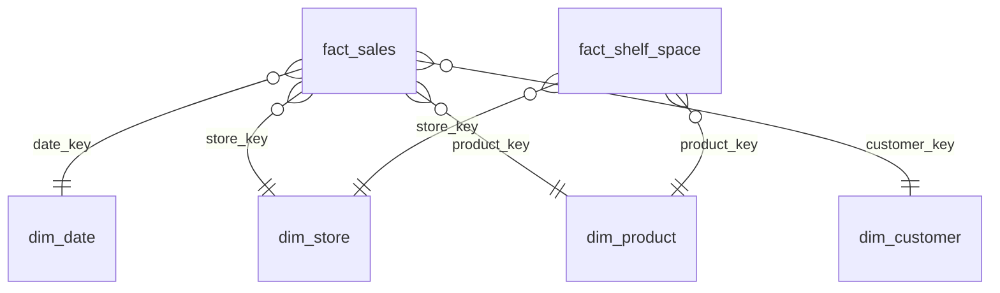

# Retail Sales Data Warehouse

A star-schema Data Warehouse for a retail chain, with the commercial KPIs a leadership team uses to track sales, margin, shelf-space productivity and loyalty.

> **Note:** this is a demo project. All data is synthetic (randomly generated) and does not belong to any company.

## Why this model

Retail teams usually have sales in the POS, products in the ERP and customers in the CRM. This model brings the three together in one place, so every KPI is calculated from a single source of truth.

## Data model



| Table | Grain | Source system |
|---|---|---|
| `fact_sales` | One row per product per ticket line | POS |
| `fact_shelf_space` | One row per product, store and month (planogram) | Planogram tool |
| `dim_product` | One row per SKU | ERP |
| `dim_store` | One row per store | ERP |
| `dim_customer` | One row per customer, with loyalty segment | CRM |
| `dim_date` | One row per day | Generated |

## KPIs included

1. Monthly net sales, tickets and average ticket
2. Gross margin and margin % by category
3. Sales per shelf meter by store and category (space productivity)
4. Share of sales and average ticket by loyalty segment
5. Repeat purchase rate

## How to run it

The scripts use standard SQL and run on SQLite, PostgreSQL or SQL Server.

```bash
sqlite3 retail.db < sql/01_schema.sql
sqlite3 retail.db < sql/02_sample_data.sql
sqlite3 retail.db < sql/03_kpi_queries.sql
```

## Files

- `sql/01_schema.sql`: tables, keys and indexes
- `sql/02_sample_data.sql`: synthetic data for Jul–Dec 2025 (4 stores, 16 products, 1,200 customers)
- `sql/03_kpi_queries.sql`: KPI queries
